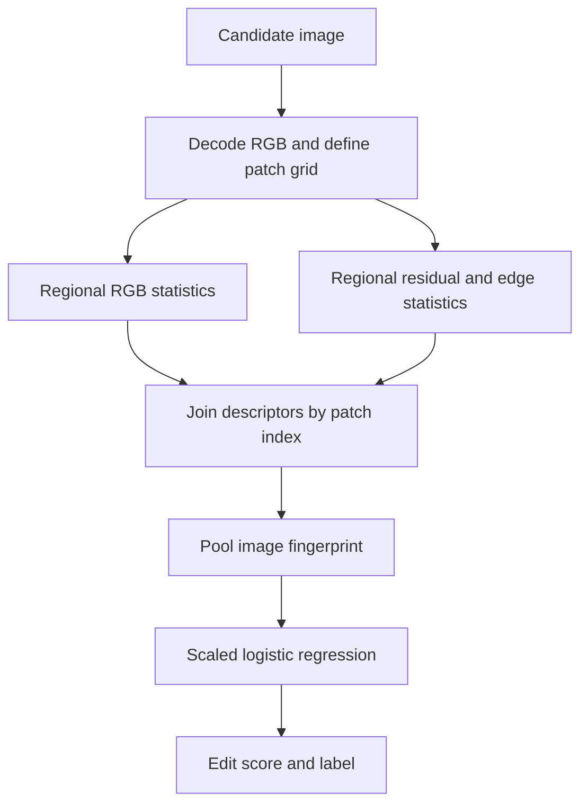

# Technical Architecture for AI Image Edit Detection

## 1. Goal and scope

Detect whether a single car photo was edited by InstructPix2Pix using low-level statistics from its pixels. The first experiment compares matched unedited and AI-edited photos on held-out source groups. A controlled negative result answers the research question. Cross-editor transfer and attribution are follow-up experiments.

The original photo and edit history are used to build and audit the dataset. At inference the only input is the candidate image. The detector returns an image-level edit score and a label at a frozen threshold.

## 2. Design inherited from the audio architecture

| Audio design | Image adaptation |
| --- | --- |
| Acoustic and rhythm streams derive complementary evidence from one waveform | An appearance stream measures RGB statistics. A residual and edge stream measures high-frequency structure from the same image. |
| Timestamps establish correspondence between linguistic units and acoustic patches | A shared 4 × 4 grid assigns the same pixel bounds and patch index to both streams. |
| Temporal cross-attention fuses evidence at overlapping intervals | The baseline joins descriptors at the same patch index and pools them. Ordered concatenation and spatial cross-attention are optional experiments. |
| A recording-level head pools fused embeddings | A CPU classifier scores the image from a fixed-length fingerprint. |
| Localization and edit-type heads use span and category labels | The first experiment uses image-level labels. Optional attribution uses known editor labels. A localization experiment would require reliable spatial annotations. |

## 3. Dataset generation and handoff

**Analysis laptop.** Preserve raw sources and record provenance and license. Assign each source a `source_id`. Group same-car, same-session, or near-duplicate photos under a `group_id`. Prepare a common RGB PNG input per source using a versioned resize and crop recipe. Use the exact prepared input pixels for the unedited control. Create one render job per source and prompt. Begin with paint-color and background-change requests.

**RTX 4060 laptop.** Load the pinned InstructPix2Pix pipeline once per run and generate one image at a time. Use a unique path per attempt and commit the output before recording success. On restart, skip verified successes and retry eligible failures with the predetermined second seed. Return native outputs, attempt logs, generation configuration, and SHA-256 checksums.

**Analysis laptop.** Verify job IDs, hashes, dimensions, and decoding before import. Review requested changes, framing, car identity, and severe corruption against a fixed rubric. Run the complete workflow on 20 pilot sources and 40 initial render jobs. Use one accepted edit per original in the main paired baseline and report accepted and excluded outputs by prompt. Export both classes with matched dimensions and encoding while preserving native files.

| Artifact | Minimum data |
| --- | --- |
| `sources.csv` | Source and group IDs, split, relative paths, hashes, and provenance |
| `jobs.csv` | Job and source IDs, input, prompt text and category, seed, and generation configuration ID |
| `attempts.jsonl` | Job ID, attempt number and seed, editor revision, settings, output path and hash, duration, and outcome |
| Analysis manifest | Image ID, path and hash, source and group IDs, split, label, and editor or control condition |
| Feature cache | Image ID and content hash, feature configuration version, and ordered numeric columns |

Each derivative inherits its source group and split. Exclude pilot and development groups from the final test set. Freeze the main train, validation, and test split at approximately 60/20/20 by group. Use metadata for auditing and fit the classifier on pixel-derived statistics alone.

## 4. Regional feature extraction

Decode with EXIF orientation applied, convert to RGB, and scale intensities to a fixed floating-point range. Use four row bands and four column bands with boundaries at `floor(i × size / 4)` for `i = 0…4`. This covers the full image when dimensions are uneven. Index patches in row-major order. Require at least two pixels per patch along each axis for the neighbor statistics.

Compute luminance, the Gaussian residual `Y − GaussianBlur(Y)`, and Sobel gradient magnitude on the full image before extracting patches. This avoids artificial edges at patch boundaries. Pin the luminance conversion, Gaussian kernel and sigma, Sobel settings, border mode, and edge threshold in the feature configuration.

| Stream | Per-patch measurements | Columns |
| --- | --- | ---: |
| Appearance | Mean and standard deviation for each RGB channel | 6 |
| Residual and edge | Residual standard deviation, horizontal and vertical residual correlation, mean Sobel magnitude, and share of pixels above the edge threshold | 5 |

Compute correlations from adjacent pixel pairs within each patch. Use zero when either paired vector has zero variance. Apply the same feature definitions and column order in training and inference.

### Spatial fusion and pooling

Join the two streams on patch index to form a `16 × 11` matrix. Compute the mean and standard deviation of each column across the patches to obtain **22 image features**. Pooling summarizes variability across patches and collapses patch position and cross-stream co-occurrence.

Compare row-major concatenation on development groups if time allows. This produces `176` features and preserves the position and pairing of regional measurements. A later learned-fusion experiment could use appearance queries and residual/edge keys and values, with attention restricted to the same cell and its immediate neighbors. Compare its performance with both statistical baselines on the same grouped splits.

## 5. Model fitting and inference

1. Fit a majority-class dummy baseline and a `StandardScaler → L2 logistic regression` pipeline on matched original/edit training pairs. Compare RGB-only, residual-only, edge-only, and combined features on identical splits.
2. Tune regularization with grouped cross-validation inside training, fitting the scaler independently in each fold. Start with `C = {0.01, 0.1, 1, 10}`. Select the feature configuration and decision threshold on validation groups using balanced accuracy.
3. Freeze the fitted pipeline, feature schema, decoder and feature configuration, positive-class mapping, and threshold together. Record dependency versions and split identifiers.
4. At inference, decode the candidate, extract the frozen fingerprint, and apply the fitted pipeline. Return `edit_score` and `label`. Apply the same threshold to the main test and robustness challenges. Compute features at the challenged size in the downscale experiment so preprocessing preserves the perturbation.

The score measures evidence of editing within the evaluated InstructPix2Pix and car-photo pipeline. It can reflect generation, reconstruction, or export effects.

## 6. Evaluation

| Experiment | What it tests |
| --- | --- |
| Paired held-out originals and accepted edits | Detection on unseen source groups |
| RGB, residual, edge, and combined feature ablations | Which feature families contribute |
| Metadata audit on development data | Whether dimensions, encoding history, or provenance offer shortcuts |
| Brightness, sharpening, and conventional recoloring | How often ordinary edits trigger the detector, including when the semantic change is matched |
| Shared JPEG and resize challenges | Whether performance survives identical transforms applied to both classes |
| Optional VAE reconstruction from the same checkpoint | Whether reconstruction alone produces detectable evidence |

Report balanced accuracy first, followed by ROC-AUC, precision, recall, F1, and the confusion matrix. Report false-positive rates for unedited and conventionally edited images separately. Include independent group counts, exclusion rates, and breakdowns by prompt and transform where sample sizes support them. Bootstrap test groups when there are enough groups for useful intervals. Discuss which results survive the controls and how the generation or export pipeline could explain the observed signal.

## 7. Cross-editor extension

Render matched jobs with a second editor after completing the core evaluation. Test transfer in both directions by training on one editor and scoring held-out originals and edits from the other. Then fit a separate classifier using `original`, `editor_A`, and `editor_B` labels. Count each original once and report macro-F1 and a confusion matrix. Interpret attribution at the editor-pipeline level unless controls isolate the model from preprocessing and export.

This design draws on the complementary streams and alignment mechanism in [architecture.md](https://chatgpt.com/library?file_id=libfile_3d21d6cc8c8881919cfa8b9baddab424&account_id=personal) and follows the dataset, compute, and evaluation scope in [plan.md](https://chatgpt.com/library?file_id=libfile_a073f1634e688191939e974030fe5370&account_id=personal).
